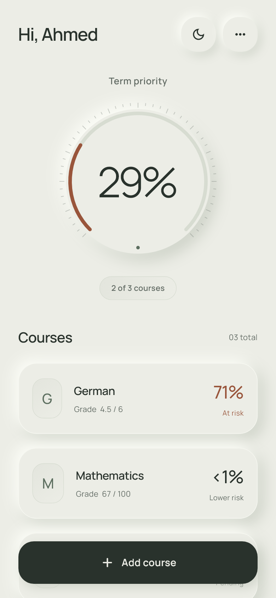
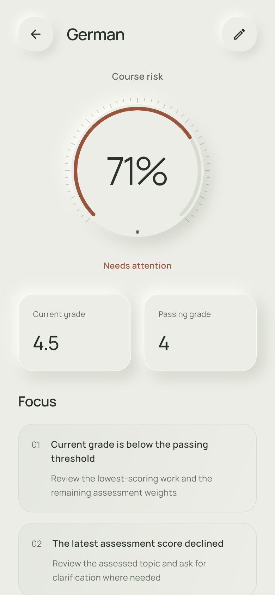
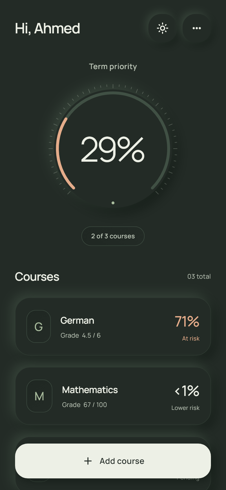
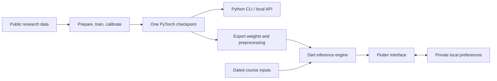

<p align="center">
  
</p>

<h1 align="center">El-Thanawiya</h1>

<p align="center"><strong>See which courses need attention. Keep your data on your phone.</strong></p>

<p align="center">
  An offline Flutter app with an on-device neural network, a companion Python API,<br>
  and a reproducible machine learning pipeline.
</p>

<p align="center">
  <a href="https://github.com/yassinabdelal-ipynb/el-thanawiya/actions/workflows/ci.yml"></a>
  <a href="LICENSE"></a>
  
  
  
</p>

<p align="center">
  <a href="https://github.com/yassinabdelal-ipynb/el-thanawiya/releases/latest">Download Android app</a> ·
  <a href="#quick-start">Quick start</a> ·
  <a href="docs/ARCHITECTURE.md">Architecture</a> ·
  <a href="docs/MODEL_CARD.md">Model card</a> ·
  <a href="CONTRIBUTING.md">Contribute</a>
</p>

<p align="center">
  
  
  
</p>

<p align="center"><sub>Actual Flutter renders with illustrative course data. The Android app starts empty.</sub></p>

## What it does

El-Thanawiya turns dated grades and assessment history into a course-level failure-risk estimate. Students can track different grading systems, see which courses need attention, and distinguish missing information from an actual zero.

- **Runs entirely on the phone.** The Android release needs no server, account, Python runtime, or internet connection. Its main manifest declares no Internet permission.
- **Understands grading direction.** Supports different grade ranges, passing thresholds, and scales where a lower grade is better.
- **Respects time.** Scores enter a prediction only after their availability date. Future scores and final-exam outcomes are excluded.
- **Shows uncertainty in the input.** Courses without observed grades receive no invented probability; incomplete assessment schedules stay unknown.
- **Makes the product usable.** First-run profile, persistent day/night themes, course editing, animated risk dials, and reduced-motion support.
- **Shares one model across runtimes.** The Flutter engine executes the exported PyTorch weights, preprocessing, missing-value handling, calibration, and alert threshold.

The term summary is a **credit-weighted priority score**, not the probability of failing the entire term. Suggestions describe entered grades and schedules; they are not causal conclusions from the model.

## Engineering evidence

| Area | Evidence in this repository |
| --- | --- |
| Cross-runtime inference | 600 synthetic numerical cases and 7 input-contract fixtures compare Dart with PyTorch; maximum recorded probability difference **3.02 × 10⁻⁷** |
| App behavior | Tests cover persistence, profile upgrades, theme changes, input handling, narrow layouts, and reduced motion |
| ML evaluation | Student-group partitions, a separate calibration partition, and a university module excluded from development |
| Reproducibility | Checksum-pinned public sources, saved split assignments, model checksum, metrics, evaluation code, and report plots |
| Privacy | Local preferences, disabled Android backup/transfer of app records, and no network inference |

See [validation notes](docs/VALIDATION.md) for current checks and the scope of earlier release verification.

## Quick start

### Try the Android app

Download `El-Thanawiya.apk` from [Releases](https://github.com/yassinabdelal-ipynb/el-thanawiya/releases/latest). The supplied v1.1.0 APK requires Android 7.0 or newer. It is a release-mode build signed with a development certificate; a Play Store release requires your own upload signing key. Physical-device testing is still outstanding.

### Run the Flutter app

Install Flutter **3.47.6** (Dart **3.13.5**) and the platform tools for your target, then:

```sh
git clone https://github.com/yassinabdelal-ipynb/el-thanawiya.git
cd el-thanawiya/forma
flutter pub get
flutter run
```

The normal app starts empty. For a temporary browser demo with illustrative data:

```sh
flutter run -d chrome --dart-define=DEMO=true
```

### Run a Python prediction

Python **3.10–3.12** is recommended for the pinned scientific dependencies. A CPU is sufficient for inference.

```sh
cd el-thanawiya/academic-risk
python -m venv .venv
# macOS/Linux: source .venv/bin/activate
# PowerShell:  .venv\Scripts\Activate.ps1
python -m pip install -r requirements.txt
python predict.py --input examples/student.json
```

For an optional local HTTP API:

```sh
python serve.py --port 8000 --allow-origin http://localhost:3000
```

The API exposes `GET /health` and `POST /predict`, binds to localhost, and loads one checkpoint once. The Android app uses its own bundled model and does not call this API. See the [Python guide](academic-risk/README.md) for input fields and integration details.

## Architecture



| Directory | Contents |
| --- | --- |
| [`forma/`](forma/) | Flutter app, Android project, web demo, model export, and UI tests |
| [`academic-risk/`](academic-risk/) | Inference CLI/API, feature processing, training, and evaluation |
| [`academic-risk/model/`](academic-risk/model/) | Checkpoint, model card, metrics, report, plots, and frozen evaluation outputs |
| [`docs/`](docs/) | Architecture, model scope, privacy, and validation notes |
| [`.github/`](.github/) | CI, dependency updates, issue forms, and pull request template |

The `forma` directory and Android application ID preserve the app's original internal name for compatibility.

## Evaluation and limits

At the model's frozen alert threshold of approximately **0.32**:

| Held-out evaluation | Accuracy | Failure recall |
| --- | ---: | ---: |
| School: first grading period | 87.3% | 85.7% |
| School: second grading period | 88.8% | 91.1% |
| University: unseen module GGG | 76.9% | 74.2% |

School results cover historical Mathematics and Portuguese courses: 205 course records per checkpoint, with repeated students and overlapping subjects. They are retrospective development evidence. They do **not** establish reliable performance across every subject, school, country, or grading policy. The university result is a separate population and exposes a meaningful generalization gap.

The network was developed from 62,867 snapshots derived from UCI Student Performance and OULAD. Grade timing uses documented proxies; OULAD withdrawals are excluded. Use the [model card](docs/MODEL_CARD.md) and [complete metrics](academic-risk/model/metrics.csv) when interpreting these results. Local validation is needed before using predictions to inform student decisions.

## Development

```sh
# From forma/
flutter analyze
flutter test

# From academic-risk/
python -m unittest discover -s tests -v

# From the repository root, after staging files
python tools/check_repository.py
```

The Python suite skips three research-data checks until the raw sources have been downloaded and prepared. CI runs the distributable inference/API tests and the Flutter suite; it does not retrain the model or download the research datasets.

See [CONTRIBUTING.md](CONTRIBUTING.md) for development and [the Flutter guide](forma/README.md) for Android builds and model export.

## Roadmap

- [ ] Test the Android release on physical devices and document the results.
- [ ] Validate with locally collected, consented data and additional high-school subjects.
- [ ] Add accessibility testing with screen readers and larger text settings.
- [ ] Prepare independent Play Store signing and distribution.

## License and attribution

Original application and pipeline code are available under the [MIT License](LICENSE). The trained model, exported weights, and derived research outputs are distributed under **CC BY 4.0** with source attribution. Manrope retains its **SIL Open Font License**. See [third-party notices](THIRD_PARTY_NOTICES.txt) and [asset licensing](docs/ASSET_LICENSES.md).
