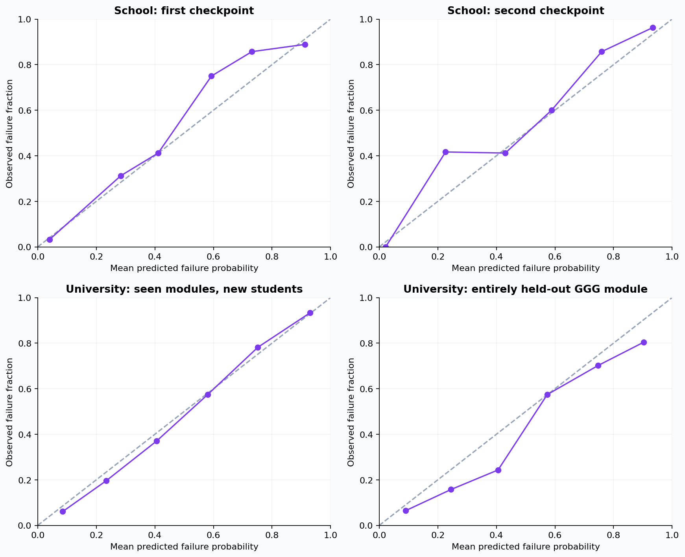

# Model card

## Purpose and status

One PyTorch neural network estimates final course failure from grades observed during an ongoing term. It is a research prototype with an offline Flutter interface. It is not validated for high-stakes automated student decisions or all new subjects.

The deployed checkpoint is `academic-risk/model/course_risk.pt`; its numerical mobile export is `forma/assets/course_risk.json`. Fourteen features feed a network with hidden layers of 32 and 16 units, SiLU activations, missingness indicators, and a learned grade-margin residual. Fitted preprocessing, calibration, and the default alert threshold are stored with the artifact. Course names and profile name/age/school grade do not select or alter a model.

## Data and splits

| Source | Use |
| --- | --- |
| UCI Student Performance | Historical Mathematics (395) and Portuguese (649) course records; first/second period snapshots |
| OULAD | 32,593 enrollments audited; 60,779 usable snapshots of graded completers at 25%, 50%, and 75% progress |
| Halabja annual grades | Audited only; excluded from the distributed model and training data because timing, passing-policy, and reuse conditions were insufficiently established |

The development table has 62,867 snapshots. All snapshots and courses belonging to a student group stay in one partition. OULAD module GGG and every student appearing in it are excluded from training, architecture selection, and calibration. Other groups are allocated approximately 60%/10%/10%/20% to training/validation/calibration/testing. School and university sources receive equal sampling weight.

Model selection compares four neural architectures on validation data. Probability calibration and the approximately 0.32 alert threshold use a separate calibration partition. The threshold selection targets macro-source failure recall of at least 0.70 while optimizing average source accuracy; that is a selection constraint, not a future guarantee.

## Frozen evaluation

| Population/checkpoint | Accuracy at alert threshold | Failure recall |
| --- | ---: | ---: |
| School, first period | 87.3% | 85.7% |
| School, second period | 88.8% | 91.1% |
| School, both checkpoints | 88.0% | 88.4% |
| Entirely held-out university module GGG | 76.9% | 74.2% |

There are 205 school course records at each test checkpoint. They include repeated snapshots and overlapping students between subjects; they are not 410 independent students. Previously inspected UCI records make this retrospective development evidence rather than external deployment validation.

Complete operating points, precision/recall, ROC/PR, calibration, and loss measurements are retained in [`metrics.csv`](../academic-risk/model/metrics.csv), [`metrics.json`](../academic-risk/model/metrics.json), and the [report](../academic-risk/model/report.html). Download the HTML to view it locally.

## Limits and assumptions

- UCI provides grading periods rather than exact release dates; term progress is proxied by checkpoint.
- OULAD score availability is assumed to occur 14 days after submission because actual mark-release dates are unavailable.
- Final-exam and banked scores are excluded. OULAD withdrawals are not labeled as course failure.
- Equal-score means and count-based coverage are fallback proxies when non-exam weights are all zero.
- Study hours map to the ordinal study-time bands supported by the source data. Attendance, topic mastery, and extracurricular hours are not supported features.
- Missingness handling does not compensate for systematic distribution shifts, biased input data, or an unvalidated local grading policy.
- Subject-name independence is a software property, not evidence of performance on a new subject.
- The model does not identify causal effects or prove that an intervention will lower risk.

Validate with consented local data, preserve student grouping, review calibration and subgroup errors, and use educator judgment before applying results to student decisions.

## Reproduction and attribution

See the [Python guide](../academic-risk/README.md). Source URLs and expected checksums live in `download_data.py`; frozen split assignments and model hashes live in `academic-risk/model/`. Raw source downloads and processed student-level tables are excluded from Git. The included prediction/split CSVs are derived from the attributed public research datasets, not app-user records.

Attribution: Paulo Cortez (2008), UCI Student Performance, [DOI 10.24432/C5TG7T](https://doi.org/10.24432/C5TG7T); Jakub Kuzilek, Martin Hlosta, and Zdenek Zdrahal, OULAD, [DOI 10.24432/C5KK69](https://doi.org/10.24432/C5KK69). Both source datasets are identified as CC BY 4.0 in the pinned source metadata. Model weights and derived research outputs retain CC BY 4.0 attribution; see [asset licensing](ASSET_LICENSES.md).
